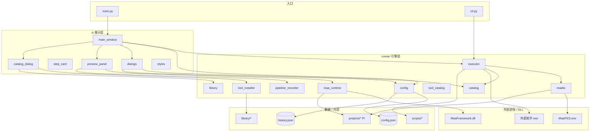
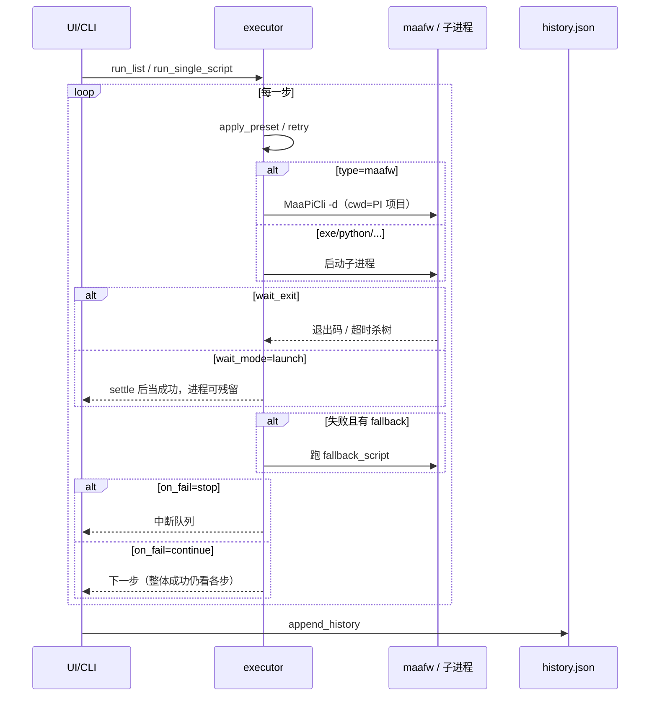
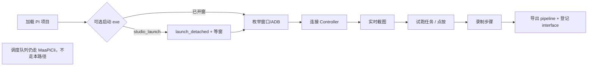
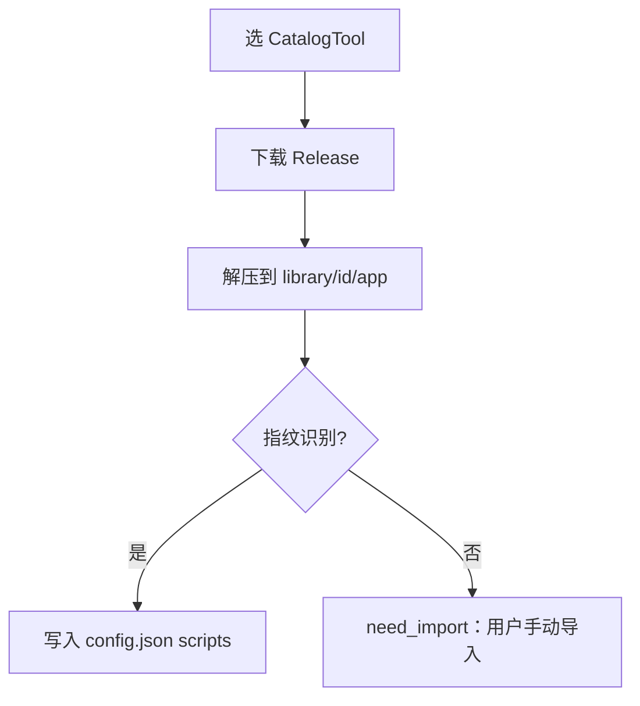

# 需求澄清：拓扑、主流程与模糊点

> 目标：确认「调度器」边界是否足够清晰；标出文档与实现不一致处，供拍板后再改代码。  
> 范围：Game Runner 本体（不含 `.cache` / `maafw` 二进制细节）。  
> 分发：日常为**源码整目录 + start.bat**（对齐 MAA）；单文件/发布包装在功能完成后再做（`build.bat --force` 为临时 onedir）。

---

## 1. 产品一句话

**桌面调度器（一键全流程）**：配置一次后点一次即跑通。对黑盒助手（如 MAA）含义是：  
`前置（模拟器）→ 打开助手 → 代点助手内「开始」→ 助手按已配任务继续`。  
「只打开 exe、仍要人手点开始」**不算**完成。

能力骨架：顺序队列 + `pre_launch` / `after_launch` + 超时/重试/失败策略/杀进程树；编辑内连控：`maafw` 录 pipeline；`exe` 助手连控取点写入 `after_launch`。

**不负责**：完整低代码 IDE、游戏内最优策略、网页壳；优先用助手 CLI/「启动即自动跑」，无则用 `after_launch` 坐标点击（UI 改版可能失效）。

### 1.1 「一点」指什么（拍板）

| 项 | 约定 |
|---|---|
| 主入口 | **运行选中队列** / 库「启动」（含该脚本 pre/after） |
| 黑盒助手 | `wait_mode=launch` + 可选 `after_launch`（窗口匹配 + 点击） |
| 禁止默认体验 | 用户再手动开游戏/再点助手「开始」 |
| 录控 | `maafw`：② 上连接+PI / 下左识图步骤（可改）/ 下右截图，导出 TemplateMatch pipeline；`exe`：同布局坐标 `after_launch.steps`；识图不进 after_launch；队列留给多脚本编排 |

### 1.2 与目标的差距（现状 → 目标）

| 场景 | 现状 | 目标 |
|---|---|---|
| 多步拉起（MuMu→Alas） | **已有** `pre_launch[]` | 配方模板（可选） |
| 助手 GUI 内点击 | **落地** `after_launch`（单点兼容 / `steps[]` 多步）+ exe ② 左列表右点选 | 录完可改坐标/延迟/删步 |
| 库行「启动」 | 跑单脚本（含 pre/after） | 已对齐主路径 |
| maafw 无人值守 | `MaaPiCli -d` + 可选 pre_launch | 同左 |

---

## 2. 模块拓扑

**硬边界（代码已遵守）：** `ui → runner` 可以；`runner → ui` 禁止。

---

## 3. 主流程

### 3.1 队列调度（无人值守）

### 3.2 录制/连控（进程内，嵌在脚本编辑）

### 3.3 游戏目录安装

---

## 4. 功能清单 vs 清晰度

| 能力 | 文档 | 代码 | 清晰度 |
|---|---|---|---|
| 顺序队列 + 停止杀树 | 有 | 有 | 清晰 |
| `type=maafw` 用 MaaPiCli | 有 | 有 | 清晰 |
| 编辑内进程连控/录制 | 有 | 有 | 清晰 |
| 脚本库 CRUD / 导入指纹 | 有 | 有 | 清晰 |
| library 安装与扫描 | 有 | 有 | 基本清晰 |
| 录制导出草稿 pipeline | 有 | 有 | 基本清晰 |
| `on_fail=continue` 整体成败 | 弱 | `overall=all(steps)` | **模糊** |
| `wait_mode=launch` + timeout | 弱 | settle 后放行、超时仍可杀 | **模糊** |
| `lists[].mode` | sequential / parallel | **已读**；parallel + `lane` + `max_parallel` | 清晰 |
| 安装必登记 vs 尽力 | 偏「尽量」 | 失败仍 ok+need_import | **模糊** |
| 双 bin（录制目录 vs 脚本 maafw_bin） | 有警告 | 有 | 易误用 |
| `runner/screencap.py` | 文档像在用 | **无引用** | **死代码** |

---

## 5. 待拍板模糊点（建议决策）

### F1 — `on_fail=continue` 时整体成功怎么算？

- **现状**：队列会跑完后续步，但任一失败 → `overall=False`，CLI 退出码 1。
- **选项 A（推荐）**：继续跑完，但整体仍失败（文档写清楚即可）。
- **选项 B**：全部跑完且无 `stop` 中断 → 整体成功（改 `overall` 算法）。

### F2 — `wait_mode` 与收尾（场景 1 已拍板）

- **`wait_exit`**：等到进程退出（maafw / CLI）。
- **`launch`**：settle → 可选 `after_launch` → 标成功并离开（不管孤儿；适合模拟器前置）。
- **`launch_wait`**：settle → `after_launch` → **继续等到进程退出/超时** → 成功后再 `cleanup`。
- **`timeout_sec`**：从启动起算；超时杀本步进程树 → 失败 → **不** cleanup。
- **`cleanup`**：`none` | `self` | `self+pre`（默认 `self`）；**仅本步 success** 且非 `launch` 时执行。`self` 杀助手进程树；`self+pre` 另杀本步 `pre_launch` 记到的 pid。

### F3 — `lists[].mode`（已拍板 B，有限并行）

- **`sequential`**：逐步跑（默认）。
- **`parallel`**：按脚本/`steps[].lane` 互斥调度；`max_parallel` 默认 2（夹紧 1–8）。
- 同名 lane 互斥；空 lane → `"default"`；不同 lane 可并行。占槽 = 整次 `run_single_script`（`launch` settle 即释放）。
- `on_fail=stop`：不再启新步，已跑步自行结束。

### F4 — 安装自动登记

- **选项 A**：尽力登记；失败提示导入（现状，补文档）。
- **选项 B**：登记失败则安装结果算失败。

### F5 — 录制导出范围

- **建议固化**：只写 PI 的 `resource/pipeline` + `interface.json`；**不**改 `config.json`；入口名 `RecStart`；模板图由编辑·录制页写入 `resource/image/`。

### F6 — `screencap.py`

- **选项 A**：删除或移入 `tools/` 归档。
- **选项 B**：作为无 MaaFw 时的降级预览（需重新接线）。

### F7 — 双 bin 策略（建议写进规则，不改行为）

- 编辑·录制 / 进程内：只用仓库 `maafw\`（与 `MaaFw==5.14.2` 对齐）。
- 队列 `type=maafw`：可用脚本级 `maafw_bin`（如 BD2 旧包），**禁止**把旧 DLL 塞进进程内录制目录。

### F8 — 一键全流程的数据模型

- **选项 A（推荐，少发明）**：一键 = 跑选中队列；复杂链路用多步（模拟器 launch → 助手 launch → maafw）。补「游戏配方」模板一键生成队列。  
- **选项 B**：脚本增加 `pre_launch: [{path, workdir, args, settle_sec}, ...]`，单脚本/库行「启动」也先跑前置再跑本体。  
- **选项 C**：A+B 都做（队列为主，库行启动走 pre_launch）。

默认按 **C**：队列仍是主一键；单脚本启动也要能自带前置，避免「只会跑队列的人才无人值守」。

---

## 6. 推荐默认拍板（未回复前 AI 按此理解）

| ID | 默认 |
|---|---|
| F1 | A：continue ≠ 整体成功 |
| F2 | launch 不管孤儿；launch_wait 等退出 + cleanup（默认 self，仅成功） |
| F3 | B：sequential 默认；parallel + lane + max_parallel=2 |
| F4 | A：尽力登记 |
| F5 | 只碰 PI 文件 |
| F6 | A：视为废弃，勿接新逻辑 |
| F7 | 双路径分离，禁止混用旧 DLL 到录制目录 |
| F8 | C：队列一键为主 + 脚本 `pre_launch[]` 支撑单点启动 |
| 管理员 | Windows 默认提权：`start.bat` + exe/`pre_launch`/录控启动；`run_as_admin: false` 可关；maafw/python 子进程不提权 |

若你改口，先改本文再改代码。

---

## 7. 相关文档

- 使用说明：[`使用说明.md`](使用说明.md)
- 仓库 README：[`../README.md`](../README.md)
- click_lab：[`../projects/click_lab/DEV.md`](../projects/click_lab/DEV.md)
- AI 分层规则：`.cursor/rules/`
- 架构检测：`tools/check_architecture.py`
